<div align="center">



<a href="https://github.com/adetopan">
  
</a>

<br/><br/>


</div>

<br/>

## `> whoami`

```js
const developer = {
  name: "Ade Topan Prayoga",
  role: "Full Stack Programmer",
  location: "Indonesia 🇮🇩",
  focus: ["Web App", "REST API", "Database Design"],
  currentlyBuilding: "Proyek web full stack",
  openToWork: true,
  motto: "Code, ship, learn, repeat.",
};
```

<br/>

## `> stack --list`

<div align="center">


</div>

<br/>

## `> stats --github`

<div align="center">


</div>

<br/>

## `> contributions --snake`

<div align="center">

<picture>
  <source media="(prefers-color-scheme: dark)" srcset="https://raw.githubusercontent.com/adetopan/adetopan/output/github-snake-dark.svg" />
  <source media="(prefers-color-scheme: light)" srcset="https://raw.githubusercontent.com/adetopan/adetopan/output/github-snake.svg" />
  
</picture>

</div>

<br/>

## `> connect --me`

<div align="center">

[](https://linkedin.com/in/adetopan)
[](https://instagram.com/adetopan)
[](mailto:email@anda.com)

<br/>


</div>
